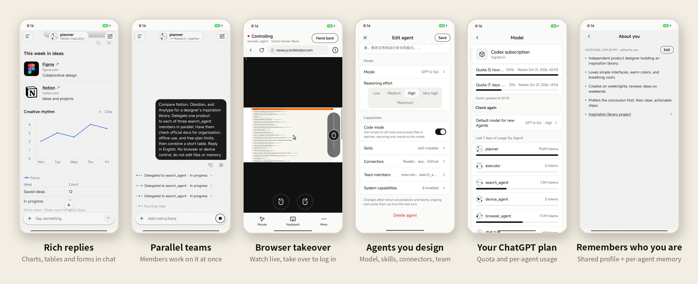

<div align="center">


# Wandrun

**Your own team of AI agents — running on your computer, in your pocket.**

Self-hosted multi-agent runtime with a native Android app.
Agents work on your machine with real files, shell and Chrome; you talk to them, watch them and take over from your phone.

English · [简体中文](README.zh-CN.md)



</div>

---

## Why Wandrun

Most agent apps run in someone else's cloud and stop when you close the tab.
Wandrun runs on **your** Linux box, keeps working while your phone is in your pocket,
and only asks you when it really needs a human — a login, a captcha, a decision.

- **Yours end to end.** Gateway, agents, files and browser profile live on your machine. The phone pairs with a one-time QR code; nothing goes through a third-party relay.
- **Uses your ChatGPT subscription.** Models are served through your own Codex login — no API keys to manage.
- **A team, not a chatbot.** Define as many agents as you like and let them delegate to each other asynchronously.

## Highlights

- **Updated chat interface** — a conversation drawer, revised message layout and a simpler composer.
- **Rich, interactive replies** — charts, tables, forms, link lists and expandable file trees mixed with text; agents are guided to use components when they fit. Form submissions become the next message. Link icons are fetched by the gateway from Google s2 with only the hostname, not the page path or query.
- **A team that works in parallel** — an agent can hand pieces of a task to other agents, keep working, and pull the results together. You see each member's progress live.
- **A browser you can take over** — agents drive a real Chrome on your machine. Watch the page from your phone and take over for logins or captchas, then hand it back.
- **Agents you design** — give each agent its own prompt, model, reasoning effort, skills, MCP connectors and team members, all from the app.
- **Runs on your ChatGPT subscription** — models come from your own Codex login. The app shows your quota and per-agent usage; no API keys to manage.

<!-- case study: added later -->

## More features

- **Files both ways** — send photos, videos and documents with resumable uploads; agent output arrives as cards you can preview, download and share.
- **Schedules** — one-off, daily, weekly or cron; each run opens a new conversation, and agents can schedule work for you.
- **Shared profile, separate working memory** — edit your shared profile in Settings → About you, and each agent's working memory on its profile page; both support a short Markdown index and on-demand details.
- **Long conversations** — automatic context compaction now checks summary structure and length and carries completed work and next steps forward; original history stays on disk. Validation does not guarantee summary accuracy or prevent all repeated work.
- **MCP & skills** — any MCP server (stdio or HTTP), searchable tool sets, Notion and GitHub OAuth from the phone, skills from `SKILL.md`.
- **Code Mode** — agents can call many tools from one short script in a sandboxed interpreter.
- **Image generation** — agents create images with your subscription and send them as attachments.
- **Search, themes, languages** — search across agents, conversations, messages and files; light and dark themes; English and Chinese UI.
- **Optional LangSmith tracing** — off by default; see [setup and privacy](docs/deploy.md#optional-langsmith-tracing) before enabling uploads of conversation, model and tool data.
- **Evaluation** — a [Harbor adapter](src/wandrun/evaluation/harbor_agent.py) with opt-in LangSmith trace parenting, plus [gateway replay](src/wandrun/evaluation/memory_eval.py) and [memory evaluators](src/wandrun/evaluation/profile_evaluators.py) for dataset experiments. These are evaluation building blocks, not an app feature.

## How it works

```
 Android app ──HTTPS / SSE / WebSocket──▶ Wandrun gateway (your computer)
                                              │
                         ┌────────────────────┼───────────────────────┐
                    Agent runtime        Dedicated Chrome        Your workspace
              (LangGraph + Deep Agents)   (CDP, per-task leases)   files · shell · MCP
                         │
                 ChatGPT subscription (Codex login)
```

The gateway is a single Python process. It stores agents, conversations and schedules in SQLite,
runs every conversation through the same agent loop, and streams progress to the app.
Each browser task gets its own page lease, so agents never see each other's tabs.

## Getting started

You need a Linux machine (Ubuntu 24.04 tested), Python 3.13 via [uv](https://docs.astral.sh/uv/),
Node.js for the Codex CLI and `agent-browser`, Google Chrome and Xvfb, a ChatGPT plan that includes
Codex, and an Android phone. The browser is a core capability: the default agent has the browser
skill, and the gateway must reach Chrome to start.

```bash
git clone https://github.com/ccpowe/wandrun.git && cd wandrun
uv sync --locked

# Browser dependencies (Ubuntu)
sudo apt install -y xvfb
wget https://dl.google.com/linux/direct/google-chrome-stable_current_amd64.deb
sudo apt install -y ./google-chrome-stable_current_amd64.deb
npm install -g agent-browser@0.38.1

# Log in once with a gateway-only Codex home (never shared with your everyday CLI)
install -d -m 700 ~/.local/share/wandrun/codex-home
CODEX_HOME=~/.local/share/wandrun/codex-home \
  npx -y @openai/codex@0.162.1 -c 'cli_auth_credentials_store="file"' login --device-auth

# In another terminal, start the agents' dedicated Chrome (on Xvfb, CDP at 127.0.0.1:9222)
uv run python -m wandrun.integrations.browser_dev --profile-dir ~/.local/share/wandrun/chrome

# Start the gateway on your LAN, then pair the phone
uv run python -m wandrun.gateway --workspace workspace --host 0.0.0.0
uv run python -m wandrun.gateway pair --workspace workspace --url http://<your-lan-ip>:8765
```

Install the app, scan the QR code, and start talking to your first agent. The first start creates
the agent `main` with the `browser` and `skill-installer` skills and the [Exa](https://exa.ai) web
search MCP server (no API key needed by default).

For an always-on server with HTTPS, the agent browser and systemd services, follow the
**[deployment guide](docs/deploy.md)**.

> [!WARNING]
> Wandrun is a single-user tool. Agents run with **your** user's file, shell and network permissions — the workspace is not a sandbox. Only expose the gateway through HTTPS or a private network.

## Getting the app

- **APK:** download from [Releases](https://github.com/ccpowe/wandrun/releases).
- **Build it yourself:** see [Build the Android app](docs/deploy.md#build-the-android-app).

iOS builds are not tested yet.

## Project layout

| Path | What it is |
| --- | --- |
| `src/wandrun/runtime/` | Agent loop, multi-agent scheduler, memory, compaction, browser leases |
| `src/wandrun/integrations/` | Codex subscription model, MCP + OAuth, local / SSH execution |
| `src/wandrun/gateway/` | HTTP / SSE API for the app, pairing, uploads, schedules, rich UI validation |
| `src/wandrun/terminal/` | Terminal chat entry (`python -m wandrun.terminal`) |
| `src/wandrun/evaluation/` | Headless runner and Harbor benchmark adapter |
| `mobile/` | Expo / React Native Android app |
| `tests/` | Python test suite (`uv run python -m unittest discover -s tests`) |

## Status

Wandrun is an early, actively developed project. The persisted state format is **not stable**
yet: upgrades may require clearing `workspace/.wandrun/state`. Issues and pull requests are welcome.

## License

[Apache License 2.0](LICENSE)
