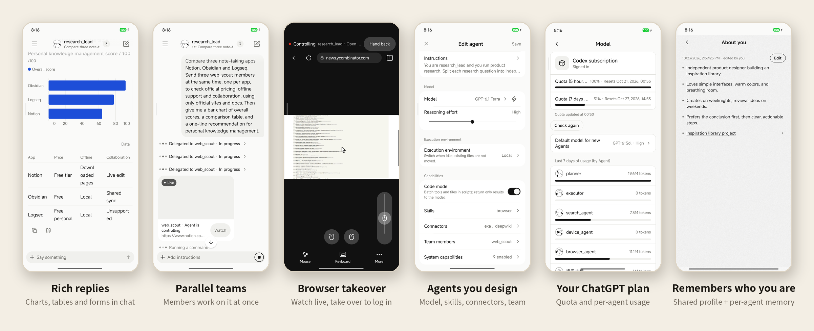

<div align="center">


# Wandrun

**Your own team of AI agents — running on your computer, in your pocket.**

Self-hosted multi-agent runtime with a native Android app.
Agents work on your machine with real files, shell and Chrome; you talk to them, watch them and take over from your phone.

English · [简体中文](README.zh-CN.md)



</div>

The first four screenshots show the v0.3.0 interface; the last two (plan quota, memory) still show the previous interface.

---

## Why Wandrun

Most agent apps run in someone else's cloud and stop when you close the tab.
Wandrun runs on **your** Linux box, keeps working while your phone is in your pocket,
and only asks you when it really needs a human — a login, a captcha, a decision.

- **Self-hosted and under your control.** Gateway state, files and browser profiles stay on your machine by default; the phone pairs with a one-time QR code. Optional Instabox execution and LiveKit video use the cloud services you configure; see [deployment and data boundaries](docs/deploy.md#optional-instabox-cloud-execution).
- **Uses your ChatGPT subscription.** Models are served through your own Codex login — no API keys to manage.
- **A team, not a chatbot.** Define as many agents as you like and let them delegate to each other asynchronously.

## Highlights

- **Chat and conversation drawer (v0.3.0)** — open straight into chat; sent messages slide below the header. Only user sends and schedule triggers reorder the drawer; unread AI replies light a red dot without reordering it. Expand team conversations from the header capsule and sort agents manually.
- **Rich, interactive replies** — charts with readouts and data tables, formulas, Mermaid, links and file trees, plus responsive layouts, tabs and expandable details. Controlled forms and send actions return to the conversation; copy actions stay local. Link icons are fetched by the gateway from Google s2 with only the hostname, not the page path or query.
- **A team that works in parallel** — an agent can hand pieces of a task to other agents, keep working, and pull the results together. You see each member's progress live.
- **A browser you can take over** — each execution environment shares a Chrome, with separate page leases for each task. Watch, take over to log in, then hand it back. Immersive portrait and landscape layouts include a control-band trackpad and a separate wheel; choose **More → Landscape** explicitly, with portrait restored on exit. Instabox optionally uses LiveKit video; missing video configuration or unsupported environments/apps use screenshots automatically. Video failures remain explicit and retryable.
- **Agents you design** — choose prompts, models, reasoning effort, skills, MCP, team members and execution environments. Optionally bind existing Instabox cloud sandboxes and inspect their status and full list on the server page.
- **Runs on your ChatGPT subscription** — models come from your own Codex login. The app shows your quota and per-agent usage; no API keys to manage.
- **Independent Fast control** — the lightning toggle beside an agent's model requests priority processing without changing reasoning effort. It is off by default and may consume more subscription quota; gateway support is not account entitlement or a latency guarantee. See [Fast support](docs/deploy.md#fast-support).

<!-- case study: added later -->

## More features

- **Files both ways** — send photos, videos and documents with resumable uploads; agent output arrives as cards you can preview, download and share. Image viewers also offer download and system sharing of the original image.
- **Schedules** — one-off, daily, weekly or cron; each run opens a new conversation, and agents can schedule work for you.
- **Shared profile, separate working memory** — edit your shared profile in Settings → About you, and each agent's working memory on its profile page; both support a short Markdown index and on-demand details.
- **Long conversations** — automatic context compaction now checks summary structure and length and carries completed work and next steps forward; original history stays on disk. Validation does not guarantee summary accuracy or prevent all repeated work.
- **MCP & skills** — remote HTTP or local stdio MCP with detected connection methods; Notion and GitHub OAuth, or your own AMap Key; searchable tool sets and skills from `SKILL.md`.
- **Code Mode** — agents can call many tools from one short script in a sandboxed interpreter.
- **Image generation** — agents create images with your subscription, optionally using reference images from their execution environment, and send them as attachments.
- **Search, themes, languages** — search across agents, conversations, messages and files; light and dark themes; English and Chinese UI.
- **Optional LangSmith tracing** — off by default; see [setup and privacy](docs/deploy.md#optional-langsmith-tracing) before enabling uploads of conversation, model and tool data.
- **Evaluation** — a [Harbor adapter](src/wandrun/evaluation/harbor_agent.py) with opt-in LangSmith trace parenting, plus [gateway replay](src/wandrun/evaluation/memory_eval.py) and [memory evaluators](src/wandrun/evaluation/profile_evaluators.py) for dataset experiments. These are evaluation building blocks, not an app feature.

## How it works

```
 Android app ──HTTPS / SSE / WebSocket──▶ Wandrun gateway (your computer)
                                              │
                         ┌────────────────────┼───────────────────────┐
                    Agent runtime       Chrome per environment    Execution environment
              (LangGraph + Deep Agents)   (CDP, per-task leases)   local / optional Instabox
                         │
                 ChatGPT subscription (Codex login)
```

The gateway is a single Python process. It stores agents, conversations and schedules in SQLite,
runs every conversation through the same agent loop, and streams progress to the app.
Each browser task gets its own page lease, so agents never see each other's tabs.
Optional video flows from the Instabox publisher through your LiveKit SFU to the app; input and authorization still go through the gateway. Browser video does not carry audio.

## Getting started

You need a Linux machine (Ubuntu 24.04 tested), Python 3.13 via [uv](https://docs.astral.sh/uv/),
Node.js for the Codex CLI and `agent-browser`, Google Chrome and Xvfb, a ChatGPT plan that includes
Codex, and an Android phone. The browser is a core capability: the default agent has the browser
skill, and the gateway must reach Chrome to start.

```bash
git clone https://github.com/ccpowe/wandrun.git && cd wandrun
uv sync --locked

# Browser dependencies (Ubuntu)
sudo apt install -y xvfb
wget https://dl.google.com/linux/direct/google-chrome-stable_current_amd64.deb
sudo apt install -y ./google-chrome-stable_current_amd64.deb
npm install -g agent-browser@0.38.1

# Log in once with a gateway-only Codex home (never shared with your everyday CLI)
install -d -m 700 ~/.local/share/wandrun/codex-home
CODEX_HOME=~/.local/share/wandrun/codex-home \
  npx -y @openai/codex@0.162.1 -c 'cli_auth_credentials_store="file"' login --device-auth

# In another terminal, start the agents' dedicated Chrome (on Xvfb, CDP at 127.0.0.1:9222)
uv run python -m wandrun.integrations.browser_dev --profile-dir ~/.local/share/wandrun/chrome

# Start the gateway on your LAN, then pair the phone
uv run python -m wandrun.gateway --workspace workspace --host 0.0.0.0
uv run python -m wandrun.gateway pair --workspace workspace --url http://<your-lan-ip>:8765
```

Install the app, scan the QR code, and start talking to `wandrun`, your guide to the app
and everyday assistant (agent id `main`). A new workspace includes the `browser`,
`skill-installer` and `wandrun-guide` skills and the [Exa](https://exa.ai) web search MCP
server (no API key needed by default), with no team members.
The checked-in workspace uses the same default skills; it contains no development-only
skills. The gateway supplies the built-in `wandrun-ui` protocol skill. New agents do not
automatically select the default agent's skills or MCP servers. Existing workspaces are
not overwritten on upgrade.

For an always-on server with HTTPS, the agent browser and systemd services, follow the
**[deployment guide](docs/deploy.md)**.

> [!WARNING]
> Wandrun is a single-user tool. Agents run with **your** user's file, shell and network permissions — the workspace is not a sandbox. Only expose the gateway through HTTPS or a private network.

## Getting the app

- **APK:** download from [Releases](https://github.com/ccpowe/wandrun/releases). v0.3.0 uses a newly signed build from `95bf9fc`; its internal app version remains **0.2.0**, Android versionCode **3**, independently of the release number.
- **Build it yourself:** see [Build the Android app](docs/deploy.md#build-the-android-app).

iOS builds are not tested yet.

## Project layout

| Path | What it is |
| --- | --- |
| `src/wandrun/runtime/` | `agent`, `communication`, `context`, `execution` and `browser` responsibilities; shared session and tracing |
| `src/wandrun/integrations/` | Codex subscription model, MCP + OAuth, local / Instabox execution and SSH transport |
| `src/wandrun/gateway/` | HTTP / SSE API for the app, pairing, uploads, schedules, rich UI validation |
| `src/wandrun/terminal/` | Terminal chat entry (`python -m wandrun.terminal`) |
| `src/wandrun/evaluation/` | Headless runner and Harbor benchmark adapter |
| `mobile/` | Expo / React Native Android app |
| `tests/` | Python test suite (`uv run python -m unittest discover -s tests`) |

## Status

Wandrun is an early, actively developed project. The persisted state format is **not stable**
yet. v0.3.0 requires gateway schema **31** and **is incompatible with old state, with no migration**; back up and use fresh state as described in [Upgrades](docs/deploy.md#upgrades). Issues and pull requests are welcome.

## License

[Apache License 2.0](LICENSE)
