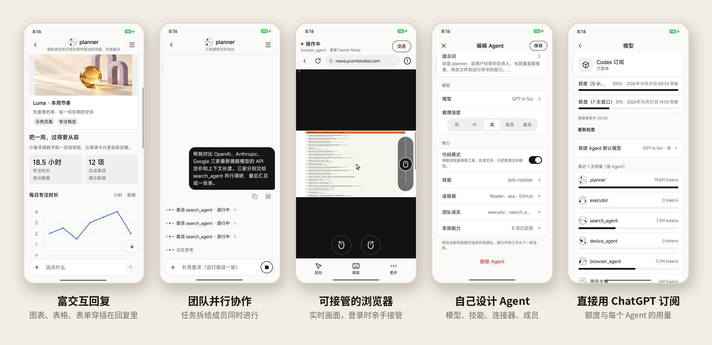

<div align="center">


# Wandrun

**属于你自己的 AI Agent 团队：跑在你的电脑上，装在你的口袋里。**

自托管的多 Agent 运行时，配一个原生 Android App。
Agent 在你的机器上使用真实的文件、命令行和 Chrome 工作；你在手机上和它们对话、看它们干活，必要时亲手接管。

[English](README.md) · 简体中文



</div>

---

## 为什么做 Wandrun

大多数 Agent 应用跑在别人的云上，关掉网页就停了。
Wandrun 跑在**你自己**的 Linux 机器上，手机揣进兜里它也照常工作，
只在真正需要人的时候找你：登录、验证码，或者需要你拍板的事。

- **从头到尾都是你的。** 网关、Agent、文件和浏览器登录状态都留在你的机器上。手机用一次性二维码配对，不经过第三方中转。
- **直接用 ChatGPT 订阅。** 模型通过你自己的 Codex 登录调用，不用管理 API Key。
- **是团队，不是聊天机器人。** 想建多少个 Agent 都行，它们之间可以异步委派工作。

## 亮点

- **富交互回复**：Agent 的回复里图文穿插图表、表格、表单和卡片；你提交的表单会作为下一条消息交回。
- **团队并行协作**：Agent 可以把任务拆给其他 Agent 并行处理，自己继续工作，最后汇总结果；每个成员的进度实时可见。
- **可接管的浏览器**：Agent 在你的机器上操作真实的 Chrome；你在手机上看实时画面，遇到登录、验证码就接管，处理完交还。
- **自己设计 Agent**：在 App 里为每个 Agent 设置提示词、模型、推理强度、技能、MCP 连接器和团队成员。
- **直接用 ChatGPT 订阅**：模型通过你自己的 Codex 登录调用，App 里能看到额度和每个 Agent 的用量，不用管理 API Key。

<!-- 案例：之后补充 -->

## 更多功能

- **双向文件**：发送照片、视频和文档，支持断点续传；Agent 产出的文件以卡片出现，可预览、下载、分享。
- **定时任务**：单次、每天、每周或 cron，每次触发开一个新对话；Agent 也能替你创建定时。
- **记忆**：每个 Agent 有一份可编辑的 Markdown 记忆，跨对话保留。
- **长对话**：自动压缩上下文，原文留在磁盘上，随时可以回查。
- **MCP 与技能**：接入任意 MCP 服务（stdio 或 HTTP），工具多时按需搜索；在手机上通过 OAuth 连接 Notion、GitHub；用 `SKILL.md` 安装技能。
- **Code Mode**：Agent 可以写一段短脚本，在沙箱解释器里一次调用多个工具。
- **生图**：Agent 用你的订阅生成图片，作为附件发给你。
- **搜索、主题、语言**：全局搜索 Agent、对话、消息和文件；浅色 / 深色主题；中英文界面。

## 工作原理

```
 Android App ──HTTPS / SSE / WebSocket──▶ Wandrun 网关（你的电脑）
                                              │
                         ┌────────────────────┼───────────────────────┐
                    Agent 运行时           专属 Chrome               你的工作区
              (LangGraph + Deep Agents)  (CDP，按任务租用页面)     文件 · 命令 · MCP
                         │
                 ChatGPT 订阅（Codex 登录）
```

网关是一个 Python 进程：Agent、对话和定时存在 SQLite 里，每个对话都走同一个 Agent 循环，
进度实时推送到 App。每个浏览器任务独占自己的页面租约，Agent 之间看不到彼此的标签页。

## 快速开始

需要一台 Linux 机器（已在 Ubuntu 24.04 上测试）、通过 [uv](https://docs.astral.sh/uv/) 安装的 Python 3.13、
用于 Codex CLI 和 `agent-browser` 的 Node.js、Google Chrome 和 Xvfb、包含 Codex 的 ChatGPT 套餐，
以及一部 Android 手机。浏览器是基础能力：默认 Agent 带 browser 技能，网关启动时必须能连上 Chrome。

```bash
git clone https://github.com/ccpowe/wandrun.git && cd wandrun
uv sync --locked

# 浏览器依赖（Ubuntu）
sudo apt install -y xvfb
wget https://dl.google.com/linux/direct/google-chrome-stable_current_amd64.deb
sudo apt install -y ./google-chrome-stable_current_amd64.deb
npm install -g agent-browser@0.38.1

# 用网关专属的 Codex 目录登录一次（不要和日常使用的 CLI 共用）
install -d -m 700 ~/.local/share/wandrun/codex-home
CODEX_HOME=~/.local/share/wandrun/codex-home \
  npx -y @openai/codex@0.162.1 -c 'cli_auth_credentials_store="file"' login --device-auth

# 在另一个终端启动 Agent 专用的 Chrome（Xvfb 上运行，CDP 在 127.0.0.1:9222）
uv run python -m wandrun.integrations.browser_dev --profile-dir ~/.local/share/wandrun/chrome

# 在局域网启动网关，然后配对手机
uv run python -m wandrun.gateway --workspace workspace --host 0.0.0.0
uv run python -m wandrun.gateway pair --workspace workspace --url http://<电脑局域网IP>:8765
```

安装 App、扫码，就可以和第一个 Agent 对话了。首次启动会创建 Agent `main`：带 `browser` 和
`skill-installer` 技能，并接入 [Exa](https://exa.ai) 网页搜索 MCP（默认不需要 API key）。

要常驻运行、配置 HTTPS、Agent 浏览器和 systemd 服务，请看 **[部署文档](docs/deploy.zh-CN.md)**。

> [!WARNING]
> Wandrun 是单用户工具。Agent 拥有**你这个系统用户**的文件、命令和网络权限，工作区不是沙箱。网关只应通过 HTTPS 或私有网络对外提供。

## 获取 App

- **APK：** 从 [Releases](https://github.com/ccpowe/wandrun/releases) 下载。
- **自行构建：** 见[构建 Android App](docs/deploy.zh-CN.md#构建-android-app)。

iOS 尚未测试。

## 目录结构

| 路径 | 内容 |
| --- | --- |
| `src/wandrun/runtime/` | Agent 循环、多 Agent 调度、记忆、上下文压缩、浏览器租约 |
| `src/wandrun/integrations/` | Codex 订阅模型、MCP 与 OAuth、本机 / SSH 执行 |
| `src/wandrun/gateway/` | 给 App 的 HTTP / SSE 接口、配对、上传、定时、富交互校验 |
| `src/wandrun/terminal/` | 终端聊天入口（`python -m wandrun.terminal`） |
| `src/wandrun/evaluation/` | 无人值守评测与 Harbor 适配 |
| `mobile/` | Expo / React Native Android App |
| `tests/` | Python 测试（`uv run python -m unittest discover -s tests`） |

## 项目状态

Wandrun 处于早期、活跃开发阶段。持久化格式**尚不稳定**，升级时可能需要清空
`workspace/.wandrun/state`。欢迎提 Issue 和 PR。

## 许可证

[Apache License 2.0](LICENSE)
