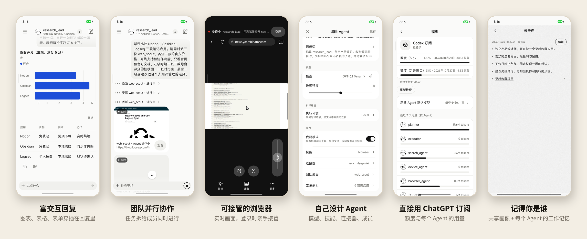

<div align="center">


# Wandrun

**属于你自己的 AI Agent 团队：跑在你的电脑上，装在你的口袋里。**

自托管的多 Agent 运行时，配一个原生 Android App。
Agent 在你的机器上使用真实的文件、命令行和 Chrome 工作；你在手机上和它们对话、看它们干活，必要时亲手接管。

[English](README.md) · 简体中文



</div>

前 4 张为 v0.3.0 界面；后 2 张（订阅额度、记忆）仍为旧版界面示意。

---

## 为什么做 Wandrun

大多数 Agent 应用跑在别人的云上，关掉网页就停了。
Wandrun 跑在**你自己**的 Linux 机器上，手机揣进兜里它也照常工作，
只在真正需要人的时候找你：登录、验证码，或者需要你拍板的事。

- **本机部署由你掌控。** 网关、Agent 状态、文件和浏览器登录状态默认留在你的机器上；手机用一次性二维码配对。可选 Instabox 云执行与 LiveKit 视频会使用你配置的云服务，见[部署与数据边界](docs/deploy.zh-CN.md#可选-instabox-云执行环境)。
- **直接用 ChatGPT 订阅。** 模型通过你自己的 Codex 登录调用，不用管理 API Key。
- **是团队，不是聊天机器人。** 想建多少个 Agent 都行，它们之间可以异步委派工作。

## 亮点

- **聊天与对话抽屉（v0.3.0）**：打开即进入聊天，新消息发送后滑到顶栏下；抽屉按用户发送和定时触发排序，未读 AI 回复亮红点但不打乱顺序。顶部胶囊展开协作子对话，Agent 列表支持手动排序。
- **富交互回复**：可读数的图表与数据表、公式、Mermaid、链接、文件树，以及响应式布局、选项卡和可折叠详情。受控表单与发送动作交回对话，复制动作留在本机；链接图标由网关向 Google s2 获取，只发送主机名，不发送页面路径或查询参数。
- **团队并行协作**：Agent 可以把任务拆给其他 Agent 并行处理，自己继续工作，最后汇总结果；每个成员的进度实时可见。
- **可接管的浏览器**：每个执行环境共享一台 Chrome，任务独占自己的标签页；在手机观看、登录或接管后交还。竖横屏沉浸式接管提供控制带触控板与独立滚轮；通过**更多 → 横屏**主动切换，离开恢复竖屏。Instabox 可选 LiveKit 视频；未配置或环境 / App 不支持视频时自动使用截图，视频失败则明确报错并可重试。
- **自己设计 Agent**：在 App 里设置提示词、模型、推理强度、技能、MCP、团队与执行环境；可选绑定已有 Instabox 云沙箱，在服务器页查看执行环境状态和完整列表。
- **直接用 ChatGPT 订阅**：模型通过你自己的 Codex 登录调用，App 里能看到额度和每个 Agent 的用量，不用管理 API Key。
- **独立 Fast 开关**：Agent 模型旁的闪电开关请求优先处理，不改变推理强度。默认关闭，可能消耗更多订阅额度；网关支持不代表账户有权限，也不保证延迟。见 [Fast 支持](docs/deploy.zh-CN.md#fast-支持)。

<!-- 案例：之后补充 -->

## 更多功能

- **双向文件**：发送照片、视频和文档，支持断点续传；Agent 产出的文件以卡片出现，可预览、下载、分享。图片查看器也支持下载原图和通过系统分享原图。
- **定时任务**：单次、每天、每周或 cron，每次触发开一个新对话；Agent 也能替你创建定时。
- **共享画像、独立工作记忆**：在“设置 → 关于你”编辑所有 Agent 共享的用户画像，在 Agent 资料页编辑各自的工作记忆；都支持简短 Markdown 索引与按需读取的详情。
- **长对话**：自动压缩上下文，新增摘要结构与长度校验，并交接已完成工作和下一步；原文留在磁盘上。校验不保证摘要语义正确，也不保证完全避免重复工作。
- **MCP 与技能**：接入远程 HTTP 或本机 stdio MCP，自动识别连接方式；通过 OAuth 连接 Notion、GitHub，或用自己的 Key 连接高德地图；工具多时按需搜索，用 `SKILL.md` 安装技能。
- **Code Mode**：Agent 可以写一段短脚本，在沙箱解释器里一次调用多个工具。
- **生图**：Agent 用你的订阅生成图片，可读取当前执行环境中的参考图片，作为附件发给你。
- **搜索、主题、语言**：全局搜索 Agent、对话、消息和文件；浅色 / 深色主题；中英文界面。
- **可选 LangSmith 追踪**：默认关闭；开启前先看[配置与隐私说明](docs/deploy.zh-CN.md#可选-langsmith-追踪)，了解对话、模型和工具数据的上传范围。
- **评测**：[Harbor 适配器](src/wandrun/evaluation/harbor_agent.py)支持按需挂接 LangSmith trace；另有[网关回放](src/wandrun/evaluation/memory_eval.py)与[记忆评分器](src/wandrun/evaluation/profile_evaluators.py)用于数据集实验。这些是评测代码，不是 App 功能。

## 工作原理

```
 Android App ──HTTPS / SSE / WebSocket──▶ Wandrun 网关（你的电脑）
                                              │
                         ┌────────────────────┼───────────────────────┐
                    Agent 运行时         按环境共享 Chrome          执行环境
              (LangGraph + Deep Agents)  (CDP，按任务租用页面)    本机 / 可选 Instabox
                         │
                 ChatGPT 订阅（Codex 登录）
```

网关是一个 Python 进程：Agent、对话和定时存在 SQLite 里，每个对话都走同一个 Agent 循环，
进度实时推送到 App。每个浏览器任务独占自己的页面租约，Agent 之间看不到彼此的标签页。
可选视频链路为 Instabox 推流端 → 你部署的 LiveKit SFU → App；输入与鉴权仍经过网关。浏览器视频不包含音频。

## 快速开始

需要一台 Linux 机器（已在 Ubuntu 24.04 上测试）、通过 [uv](https://docs.astral.sh/uv/) 安装的 Python 3.13、
用于 Codex CLI 和 `agent-browser` 的 Node.js、Google Chrome 和 Xvfb、包含 Codex 的 ChatGPT 套餐，
以及一部 Android 手机。浏览器是基础能力：默认 Agent 带 browser 技能，网关启动时必须能连上 Chrome。

```bash
git clone https://github.com/ccpowe/wandrun.git && cd wandrun
uv sync --locked

# 浏览器依赖（Ubuntu）
sudo apt install -y xvfb
wget https://dl.google.com/linux/direct/google-chrome-stable_current_amd64.deb
sudo apt install -y ./google-chrome-stable_current_amd64.deb
npm install -g agent-browser@0.38.1

# 用网关专属的 Codex 目录登录一次（不要和日常使用的 CLI 共用）
install -d -m 700 ~/.local/share/wandrun/codex-home
CODEX_HOME=~/.local/share/wandrun/codex-home \
  npx -y @openai/codex@0.162.1 -c 'cli_auth_credentials_store="file"' login --device-auth

# 在另一个终端启动 Agent 专用的 Chrome（Xvfb 上运行，CDP 在 127.0.0.1:9222）
uv run python -m wandrun.integrations.browser_dev --profile-dir ~/.local/share/wandrun/chrome

# 在局域网启动网关，然后配对手机
uv run python -m wandrun.gateway --workspace workspace --host 0.0.0.0
uv run python -m wandrun.gateway pair --workspace workspace --url http://<电脑局域网IP>:8765
```

安装 App、扫码，就可以和 `wandrun` 对话：它既教你使用 App，也帮你完成日常任务（技术 id 为 `main`）。
新工作区默认带 `browser`、`skill-installer`、`wandrun-guide` 三个技能，
接入 [Exa](https://exa.ai) 网页搜索 MCP（默认不需要 API key），没有团队成员。
仓库自带工作区也只含这些默认技能，不附开发专用技能；网关自动提供 `wandrun-ui` 富交互协议技能。
新建 Agent 不会自动勾选默认 Agent 的技能或 MCP；升级不覆盖已有工作区。

要常驻运行、配置 HTTPS、Agent 浏览器和 systemd 服务，请看 **[部署文档](docs/deploy.zh-CN.md)**。

> [!WARNING]
> Wandrun 是单用户工具。Agent 拥有**你这个系统用户**的文件、命令和网络权限，工作区不是沙箱。网关只应通过 HTTPS 或私有网络对外提供。

## 获取 App

- **APK：** 从 [Releases](https://github.com/ccpowe/wandrun/releases) 下载。v0.3.0 使用来自 `95bf9fc` 的新签名构建；App 内部版本仍为 **0.2.0**、Android versionCode **3**，与发布号独立。
- **自行构建：** 见[构建 Android App](docs/deploy.zh-CN.md#构建-android-app)。

iOS 尚未测试。

## 目录结构

| 路径 | 内容 |
| --- | --- |
| `src/wandrun/runtime/` | `agent`、`communication`、`context`、`execution`、`browser` 职责分组，以及共享会话和追踪 |
| `src/wandrun/integrations/` | Codex 订阅模型、MCP 与 OAuth、本机 / Instabox 执行及 SSH 传输 |
| `src/wandrun/gateway/` | 给 App 的 HTTP / SSE 接口、配对、上传、定时、富交互校验 |
| `src/wandrun/terminal/` | 终端聊天入口（`python -m wandrun.terminal`） |
| `src/wandrun/evaluation/` | 无人值守评测与 Harbor 适配 |
| `mobile/` | Expo / React Native Android App |
| `tests/` | Python 测试（`uv run python -m unittest discover -s tests`） |

## 项目状态

Wandrun 处于早期、活跃开发阶段，持久化格式**尚不稳定**。v0.3.0 要求网关结构版本 **31**，
**不兼容旧 state，不提供迁移**；升级前备份并按[升级说明](docs/deploy.zh-CN.md#升级)使用全新状态。欢迎提 Issue 和 PR。

## 许可证

[Apache License 2.0](LICENSE)
